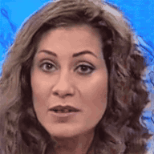
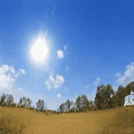
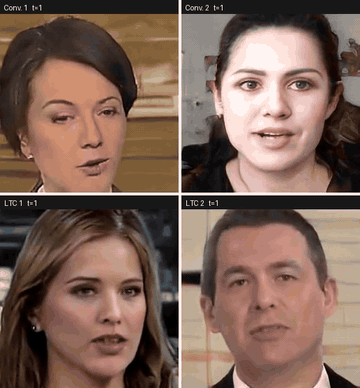

# LVGAN: Continuous-Time Motion States for Adversarial Video Generation
### A controlled study in StyleGAN-V

**Hector Anaya-Sanchez, Leopoldo Altamirano-Robles, Raquel Díaz-Hernández, Saúl Zapotecas-Martínez**
Instituto Nacional de Astrofísica, Óptica y Electrónica (INAOE), Puebla, Mexico

LVGAN (Liquid Video GAN) replaces the convolutional motion network of
[StyleGAN-V](https://github.com/universome/stylegan-v) with a compact
**continuous-time cell** in the spirit of liquid time-constant (LTC) networks. The cell has
input- and state-dependent time constants, a bounded state, closed-form exponential updates,
and **1.31 M parameters, 4.4× fewer** than the network it replaces. Everything else is
inherited unchanged from StyleGAN-V: the synthesis backbone, the discriminator, the objective
and the training recipe. As a result, **the motion network is the only difference** between
the two configurations we compare.

This repository is a fork of the official StyleGAN-V code. It also contains the reference
`ncps` LTC/CfC cells, a hand-written CfC cell, the matched-ablation tooling and the
cost-measurement scripts used in the paper.

<table>
<tr>
<th>FaceForensics</th><th>Sky Time-lapse</th><th>UCF101</th>
</tr>
<tr>
<td></td>
<td></td>
<td></td>
</tr>
</table>

*LVGAN samples at 256×256. The previews show the first 6 s of each clip. The full 512-frame
(20.5 s) rollouts are in [assets/videos/](assets/videos/):
[FaceForensics](assets/videos/fig3-4_faceforensics_ltc_clip018.mp4) ·
[Sky](assets/videos/fig3-4_sky_ltc_clip005.mp4) ·
[UCF101](assets/videos/fig3-4_ucf101_ltc_clip022.mp4).*

---

## Contents

- [What changes, and what does not](#what-changes-and-what-does-not)
- [Results](#results)
- [Installation](#installation)
- [Data](#data)
- [Training](#training)
- [Inference](#inference)
- [Evaluation](#evaluation)
- [Measuring cost](#measuring-cost)
- [Troubleshooting](#troubleshooting)
- [Tests](#tests)
- [License](#license) · [Citation](#citation)

---

## What changes, and what does not

StyleGAN-V decomposes a video into a static **content** code $w$, shared by every frame, and
a per-frame **motion** code $v_t$. Both codes condition a StyleGAN2 synthesis network. The
network renders each frame from a continuous time coordinate, so a sequence of any length
costs **one synthesis forward pass per frame**, with no recurrence over pixels.

LVGAN changes only the network that turns a noise trajectory $u_1,\dots,u_T$ into grid codes
$m_k$. The backbone uses two stacked, unpadded `Conv1d` layers (kernel 11). Each grid code
therefore depends on a fixed window of 21 trajectory states. LVGAN uses a recurrent cell with
hidden state $x\in\mathbb{R}^{H}$:

$$
\tau(x,u) = \mathrm{softplus}\big(W_\tau[x;u] + \tau_0\big) + \epsilon,
\qquad
f(x,u) = \tanh\big(W_f[x;u]\big)\odot\mathrm{softplus}(A),
$$

$$
\frac{dx}{dt} = \big(f(x,u) - x\big)\oslash\tau(x,u).
$$

Each neuron relaxes toward its target at a rate set by its own input-dependent time constant.
Freezing $\tau$ and $f$ over a sub-step of length $\delta$ makes this linear, and its exact
solution gives the update

$$
x \leftarrow e^{-\delta/\tau}\odot x + \big(1 - e^{-\delta/\tau}\big)\odot f .
$$

One motion interval is covered by $K$ such sub-steps, with $\tau$ and $f$ re-evaluated
between them. This is an exponential-Euler scheme, explicit and matrix-free. Two properties
follow:

- **The state is bounded by construction.** Each update is a convex combination of the
  previous state and the target. Since $|f_i| < \mathrm{softplus}(A_i)$ and $x(0)=0$, every
  coordinate stays in $(-\mathrm{softplus}(A_i), \mathrm{softplus}(A_i))$ for any input
  sequence, without clipping.
- **The update is stable for any step size.** An explicit Euler step loses this property as
  soon as $\delta > \tau$.

We use $H = 512$ and $K = 6$. $W_\tau$ and $W_f$ are equalized-LR layers with
`lr_multiplier=0.01`, the same setting as the convolution they replace. The motion code is
then produced exactly as in StyleGAN-V: the two neighbouring grid codes are interpolated at
time $t$ and passed through the acyclic Fourier time encoder.

The cell is **not** the conductance-based LTC model with synaptic reversal potentials. It also
does not use CfC's single sigmoid-gated step. It borrows input-adaptive time constants from
LTC and the closed-form update from CfC. In the code it is called `exp_cf`
(`ExpClosedFormCell` in [src/training/motion.py](src/training/motion.py)). The genuine
reference cells are available as `ncps_ltc` and `ncps_cfc` (see
[Motion strategies](#motion-strategies)).

---

## Results

All runs are at 256×256 on 2× A100-40GB, with a global batch of 64, for 25,000 kimg (about 3
days per run). Both configurations use the same codebase, seed, data pipeline and evaluation
scripts. Checkpoints are selected by the StyleGAN-V rule: take the snapshot with the lowest
FVD-16f and read **every** metric from that snapshot.

The metrics are defined precisely, because FVD depends on how clips are formed:

| Metric | Clips scored |
|---|---|
| `FVD-16f` | 16 consecutive frames |
| `FVD-128f` | 128 consecutive frames (dense long horizon) |
| `FVD-128f-sub8` | 16 frames taken every 8th frame, spanning 128 (the **stride-matched** metric) |
| `FID` | 50k frames against the full training set |

FVD-16f and FVD-128f-sub8 score clips of the same length and differ only in temporal span.

### Matched comparison (lower is better)

| Dataset | Motion network | FVD-16f | FVD-128f | FVD-128f-sub8 | FID |
|---|---|---:|---:|---:|---:|
| FaceForensics | Conv1d (backbone) | 53.8 | 76.2 | 83.0 | 15.7 |
| | **Liquid cell (ours)** | **45.2** | **68.4** | **75.8** | **13.6** |
| Sky Time-lapse | Conv1d (backbone) | 50.9 | **195.6** | 104.1 | **43.8** |
| | **Liquid cell (ours)** | **43.3** | 230.9 | **97.7** | 44.0 |
| UCF101 | Conv1d (backbone) | 1589.5 | 2054.8 | 1658.0 | 50.0 |
| | **Liquid cell (ours)** | **1515.0** | **1980.2** | **1591.8** | **47.9** |

Two metrics favour the cell on all three datasets: **FVD-16f** and the **stride-matched
FVD-128f-sub8**. Dense FVD-128f and per-frame FID favour it on two of three; the exception is
Sky Time-lapse. Widening the span eightfold costs both networks about the same. The cell
starts from a better position and keeps it, but it does not degrade more slowly.

### Motion-state spacing on Sky Time-lapse

StyleGAN-V uses $\Delta = 256$ for Sky Time-lapse without giving a reason. At that spacing
every evaluated clip lies inside the first motion interval, so the evaluation cannot observe
the cell's dynamics. We therefore retrained both networks at $\Delta = 16$, the value used on
the other datasets:

| $\Delta$ | Motion network | FVD-16f | FVD-128f | FVD-128f-sub8 | FID |
|---|---|---:|---:|---:|---:|
| 256 | Conv1d | 50.9 | **195.6** | 104.1 | **43.8** |
| | Liquid cell | **43.3** | 230.9 | **97.7** | 44.0 |
| 16 | Conv1d | **47.8** | **125.3** | 143.1 | 43.1 |
| | Liquid cell | 49.9 | 134.5 | **137.7** | **42.8** |

The short-horizon advantage on Sky reverses at $\Delta = 16$. **The stride-matched ordering
holds at both spacings**, and of all our results it has the widest support.

### Long-horizon rollouts: conv vs. liquid

<p align="center">

</p>

*FaceForensics. Top row: the convolutional motion network. Bottom row: the liquid cell. Each
row shows the first two samples of its set, with no selection on quality. Full 512-frame
version: [fig5_comparison_grid.mp4](assets/videos/fig5_comparison_grid.mp4).*

We provide no quantitative metric beyond 128 frames. The 512-frame rollouts are a qualitative
observation on a few samples. They do not show that long-horizon collapse is absent, and they
do not show a long-horizon difference between the two networks.

> **Provenance of the sample videos.** The LVGAN clips come from a re-run with `seed: 1` at
> its 25,000 kimg snapshot. Every number in the tables comes from the `seed: 0` runs. In the
> comparison grid, the conv rows are `seed: 0` and the liquid rows are `seed: 1`. Truncation
> psi at sampling time was not recorded.

### Computational cost

| | Conv1d | Liquid cell |
|---|---:|---:|
| Motion sub-network | 5.77 M | **1.31 M** |
| Motion module incl. shared Fourier encoder | 6.29 M | **1.84 M** |
| Generator (total) | 32.11 M | **27.65 M** |
| Discriminator | 25.33 M | 25.33 M |
| Synthesis passes per frame | 1 | 1 |
| A100 sampling, 128-frame clip (fused CUDA ops) | **0.198 s** | 0.295 s |
| RTX 4070 Ti sampling (native PyTorch fallback) | **1.103 s** | 1.185 s |
| Training throughput (2× A100) | **647.5 kimg/h** | 462.7 kimg/h |

The parameter saving is not a saving in time. The $K$ sub-steps are sequential, so training
throughput drops by 28.5% and A100 sampling takes 48.8% longer. The overhead *grows* on faster
hardware. Fused kernels speed up the backbone 5.6×, but the cell's 396 sequential small
updates are bound by kernel-launch latency and barely speed up. A smaller $K$, a single
CfC-style step, or a fused kernel could reduce this cost. None of these was evaluated.

---

## Installation

### Pinned environment (do not modernize)

Every completed run used exactly these versions:

```
python 3.9   torch 1.9.0+cu111   torchvision 0.10.0+cu111   numpy 1.22.4
hydra-core 1.0.7   omegaconf 2.0.6   ncps 1.0.1
```

**Do not substitute a newer torch.**
[conv2d_gradfix.py](src/torch_utils/ops/conv2d_gradfix.py) enables its custom op only on
torch 1.7–1.10. On torch 2.x it silently falls back to `F.conv2d`, which changes the kernels
used in the R1 double-backward. Results are then no longer comparable to ours, and the only
warning is a single `warnings.warn`. `environment.yaml` and `environment-ampere.yaml` are
upstream leftovers and **do not** reproduce this environment.

Packaging traps you will hit on a current package index:

| Pin | Why |
|---|---|
| `pip<24.1` | omegaconf 2.0.6 has `PyYAML (>=5.1.*)` metadata that newer pip rejects, which makes hydra 1.0.7 uninstallable. |
| `setuptools<81` | setuptools 81 dropped `pkg_resources`, which `torch.utils.cpp_extension` imports. Without it, every custom op fails. |
| `numpy<2` via a **constraints file** | opencv declares `numpy>=2` and will pull it back in. Use `PIP_CONSTRAINT`. |
| `moviepy<2` | moviepy 2 removed `moviepy.editor`. |
| `ncps==1.0.1` | 0.0.2 has an incompatible API. `motion.py` tolerates a failed import, so check `_NCPS_AVAILABLE`, not just `import ncps`. |
| `psutil`, `pandas` | Required, but missing from upstream's yaml. |

### Cluster setup scripts

- **Huapáctic (LNS-BUAP)**: run [src/infra/setup_huapactic.sh](src/infra/setup_huapactic.sh)
  on the login node, then [src/infra/smoke_test_huapactic.sh](src/infra/smoke_test_huapactic.sh)
  on a `gpu2` node. CUDA 11.1 comes from the `CUDA/11.1.1-GCC-10.2.0` module, and the host
  compiler from conda's `gcc_linux-64=10` (the compute-node image is missing `features.h`).
  The smoke test checks versions against the pins, compiles the custom ops, and runs a
  double-backward through `conv2d_gradfix`. Use those three checks as a template for other
  machines.
- **gpuserver02 (INAOE)**: [configs/env/local.yaml](configs/env/local.yaml).

### JIT-compiled CUDA ops

```bash
export TORCH_CUDA_ARCH_LIST="8.0"   # A100 (sm_80); "7.0" for V100
```

---

## Data

The dataset is a `.zip` archive (default) or a directory with one sub-folder of frames per video:

```
dataset/
    video1/
        frame1.jpg
        frame2.jpg
        ...
    video2/
        ...
```

By default `dataset.path` is `data/<dataset.name>.zip`. To train from a directory, remove the
`.zip` suffix in [configs/dataset/base.yaml](configs/dataset/base.yaml).

| Dataset | Source | Preprocessing |
|---|---|---|
| FaceForensics | https://github.com/ondyari/FaceForensics | [src/scripts/preprocess_ffs.py](src/scripts/preprocess_ffs.py) (face crops) |
| Sky Time-lapse | https://github.com/weixiong-ur/mdgan | resize to 256×256 |
| UCF101 | https://www.crcv.ucf.edu/data/UCF101.php | [preprocess_ucf101.py](preprocess_ucf101.py): train+test, all 101 classes, unconditional, center-crop and resize to 256, native FPS |

```bash
python preprocess_ucf101.py --src /path/to/ucf101_videos --dst /path/to/ucf101_256 --size 256 --workers 8
```

Configs for the upstream datasets (`mead`, `rainbow_jelly`, `taichi`) are kept in
[configs/dataset/](configs/dataset/). For a custom dataset, copy
[configs/dataset/ffs.yaml](configs/dataset/ffs.yaml).

---

## Training

**The default motion network in [configs/model/stylegan-v.yaml](configs/model/stylegan-v.yaml)
is `exp_cf`, the LVGAN cell, and not the upstream convolution.** To train the StyleGAN-V
baseline, pass `model.generator.motion.gen_strategy=conv`.

### Reproducing the matched comparison

The training settings are the same for every run in the paper: batch 64, 25,000 kimg,
ADA (target 0.6), $p_\mathrm{mix}=0$, $\lambda_\mathrm{pl}=0$, 3 frames per clip with gaps
of up to 32, and `seed=0`. These are the defaults in
[configs/training/base.yaml](configs/training/base.yaml) and
[configs/sampling/random.yaml](configs/sampling/random.yaml).

```bash
# LVGAN, FaceForensics (Δ = 16)
python src/infra/launch.py hydra.run.dir=. exp_suffix=ltc env=local dataset=ffs \
  dataset.resolution=256 num_gpus=2 \
  model.generator.motion.gen_strategy=exp_cf \
  model.generator.motion.ltc_hidden_dim=512 model.generator.motion.ltc_ode_unfolds=6

# Conv1d baseline, FaceForensics: identical except for the motion network
python src/infra/launch.py hydra.run.dir=. exp_suffix=conv env=local dataset=ffs \
  dataset.resolution=256 num_gpus=2 model.generator.motion.gen_strategy=conv

# Sky Time-lapse: the inherited Δ = 256 (Δ = 16 for the spacing ablation)
python src/infra/launch.py hydra.run.dir=. exp_suffix=ltc env=local dataset=sky_timelapse \
  dataset.resolution=256 num_gpus=2 model.generator.motion.gen_strategy=exp_cf \
  model.generator.time_enc.min_period_len=256

# UCF101
python src/infra/launch.py hydra.run.dir=. exp_suffix=ltc env=local dataset=ucf101 \
  dataset.resolution=256 num_gpus=2 model.generator.motion.gen_strategy=exp_cf
```

`model.generator.motion.motion_z_distance` (the grid spacing $\Delta$) is tied to
`time_enc.min_period_len`, so changing one changes both. In the Sky spacing ablation, this
means the motion grid and the Fourier encoder cannot be varied separately.

### Motion strategies

Set the motion network with `model.generator.motion.gen_strategy`. All strategies are in
[src/training/motion.py](src/training/motion.py).

| Strategy | Description |
|---|---|
| `exp_cf` (default) | **LVGAN cell.** Input-dependent τ with an exponential closed-form update, `ltc_ode_unfolds` sub-steps per interval. `ltc` is a deprecated alias that old runs still resume under. |
| `conv` | Upstream StyleGAN-V: two `EqLRConv1d` layers, kernel 11, fixed 21-state window. |
| `cfc` | Hand-written CfC (Hasani et al., 2022) with a sigmoid gate and one closed-form step per interval (`cfc_hidden_dim`). |
| `ncps_ltc` | Reference solver-based LTC from `ncps`. **fp32 only**. Memory scales as B·units²·T·unfolds, so use `ncps_ltc_use_checkpoint=true`. |
| `ncps_cfc` | Reference CfC from `ncps`, with `ncps_cfc_mode` = `default` / `pure` / `no_gate`. |
| `autoregressive` | LSTM, from upstream. Can diverge for large *t*. |

**Learning-rate parity.** Our layers use equalized LR, but the `ncps` cores are plain
`nn.Parameter`s. Adam is invariant to gradient scale, so without a correction the ncps arms
would train orders of magnitude faster. `construct_optimizer_params` in
[training_loop.py](src/training/training_loop.py) therefore puts them in a separate param group
at `lr * lr_multiplier`. Effective LRs are then comparable but not identical.

### SLURM, resume, and logging

```bash
# Submit as a SLURM job (sbatch args in configs/infra.yaml)
python src/infra/launch.py ... slurm=true
# Huapáctic: add the GPU partition, otherwise the job lands on a CPU-only queue
python src/infra/launch.py ... env=huapactic slurm=true sbatch_args.partition=gpu2

# Resume (git hash + exp_suffix must match the original run)
python src/infra/launch.py ... training.resume=latest

# Suppress hydra log directories
python src/infra/launch.py ... hydra.output_subdir=null hydra/job_logging=disabled hydra/hydra_logging=disabled
```

Experiments are written to `experiments/<dataset>_<model>_<sampling>_<exp_suffix>-<git_hash>/`.

---

## Inference

```bash
# 25 videos of 128 frames as a 5x5 grid
python src/scripts/generate.py --network_pkl /path/to/network-snapshot.pkl \
  --num_videos 25 --as_grids true --save_as_mp4 true --fps 25 --video_len 128 \
  --batch_size 25 --outdir /path/to/output --truncation_psi 0.9

# Pick the best snapshot of a run automatically (lowest fvd2048_16f)
python src/scripts/generate.py --networks_dir PATH_TO_EXPERIMENT/output ...

# Content/motion decomposition grid
python src/scripts/generate.py --networks_dir PATH_TO_EXPERIMENT/output \
  --moco_decomposition 1 --as_grids true --save_as_mp4 true ...
```

The cell is rolled out recurrently, so `--video_len` can exceed the training horizon. Our
512-frame samples were generated this way.

---

## Evaluation

The FVD (I3D, Kinetics-400) and FID implementations are StyleGAN-V's TorchScript ports, which
match the original TensorFlow numbers to numerical precision. All four metrics are computed
at every snapshot during training.

```bash
# Between two datasets (zip or directory)
python src/scripts/calc_metrics_for_dataset.py \
  --real_data_path /path/to/real.zip --fake_data_path /path/to/fake.zip \
  --mirror 1 --gpus 2 --resolution 256 \
  --metrics fvd2048_16f,fvd2048_128f,fvd2048_128f_subsample8f,fid50k_full \
  --verbose 0 --use_cache 0

# For a trained model
python src/scripts/calc_metrics.py --network_pkl /path/to/network-snapshot.pkl \
  --metrics fvd2048_16f,fvd2048_128f,fvd2048_128f_subsample8f,fid50k_full --gpus 2
```

`fvd2048_128f_subsample8f` is the stride-matched metric (FVD-128f-sub8 in the tables).

---

## Measuring cost

```bash
# Parameter counts and seconds per 128-frame clip, one strategy at a time
python src/scripts/benchmark_sampling.py --config PATH_TO_EXPERIMENT/experiment_config.yaml \
  --gen_strategy conv   --video_len 128 --warmup 5 --iters 25 --json_out conv.json
python src/scripts/benchmark_sampling.py --config PATH_TO_EXPERIMENT/experiment_config.yaml \
  --gen_strategy exp_cf --video_len 128 --warmup 5 --iters 25 --json_out ltc.json

# Steady-state training throughput (kimg/h) from log.txt / stats.jsonl
python src/scripts/parse_training_throughput.py --run PATH/run_a --run PATH/run_b --skip_ticks 10
```

Sampling time depends heavily on whether the fused CUDA ops compiled (see
[Computational cost](#computational-cost)). Report the setup you measured on.

---

## Troubleshooting

- **A JIT build hangs forever.** A job killed mid-build (SLURM time limit, Ctrl-C) leaves a
  `lock` file in `TORCH_EXTENSIONS_DIR`, and the next run waits on it indefinitely. Delete
  stale `lock` files before re-running. To tell a slow build from a deadlock, set
  `custom_ops.verbosity = 'full'` in [custom_ops.py](src/torch_utils/custom_ops.py).
- **`No CUDA runtime is found`, or CUDA 13 libraries in a cu111 env.** Take CUDA from a system
  module or toolkit with the standard `include/` + `lib64/` layout, not from conda's
  `cuda-libraries-dev`.
- **`gen_strategy=ncps_*` fails at model construction.** `ncps` is the wrong version. Check
  `src.training.motion._NCPS_AVAILABLE`.
- **`import torch` warns about NumPy.** numpy ≥ 2 is installed. torch 1.9 requires `numpy<2`.
- **Verify correctness, not just presence.** Compare installed versions to the pins, call
  `torch.from_numpy`, and run a double-backward through `conv2d_gradfix.conv2d`.

---

## Tests

```bash
python -m pytest tests/
```

[tests/test_motion_networks.py](tests/test_motion_networks.py) covers the motion strategies.
[tests/test_data_utils.py](tests/test_data_utils.py) covers the data utilities.

---

## License

This code is built on [StyleGAN-V](https://github.com/universome/stylegan-v), which builds on
[INR-GAN](https://github.com/universome/inr-gan) and
[StyleGAN2-ADA](https://github.com/NVlabs/stylegan2-ada-pytorch). It is therefore likely
subject to the [NVIDIA Source Code License](https://nvlabs.github.io/stylegan2-ada-pytorch/license.html).

## Acknowledgements

This work was supported by the Secretaría de Ciencia, Humanidades, Tecnología e Innovación
(SECIHTI), Mexico, through its graduate scholarship program. We thank the StyleGAN-V authors
for releasing their code and evaluation protocol, and the authors of
[`ncps`](https://github.com/mlech26l/ncps) for the reference LTC/CfC implementations.

## Citation

If you use this code, please cite the backbone:

```bibtex
@inproceedings{stylegan_v,
    title     = {StyleGAN-V: A Continuous Video Generator with the Price, Image Quality and Perks of StyleGAN2},
    author    = {Skorokhodov, Ivan and Tulyakov, Sergey and Elhoseiny, Mohamed},
    booktitle = {Proceedings of the IEEE/CVF Conference on Computer Vision and Pattern Recognition (CVPR)},
    year      = {2022}
}
```

A citation for the LVGAN paper will be added once it is published.
